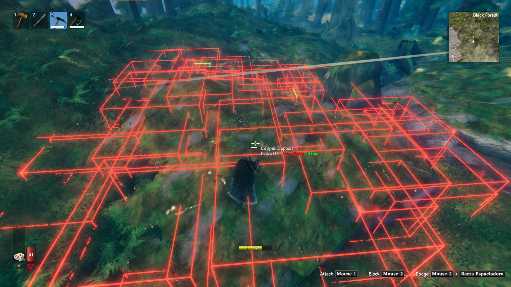
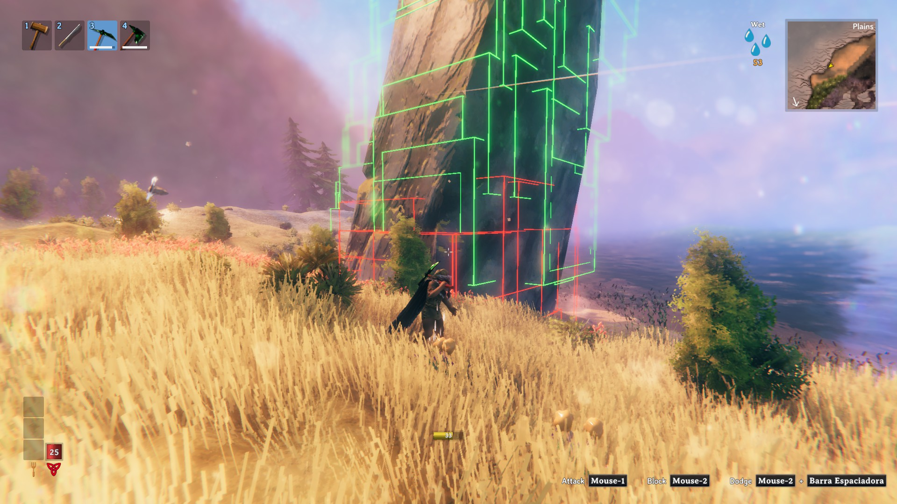
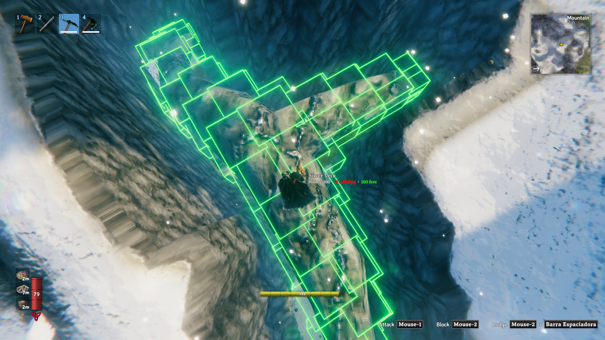
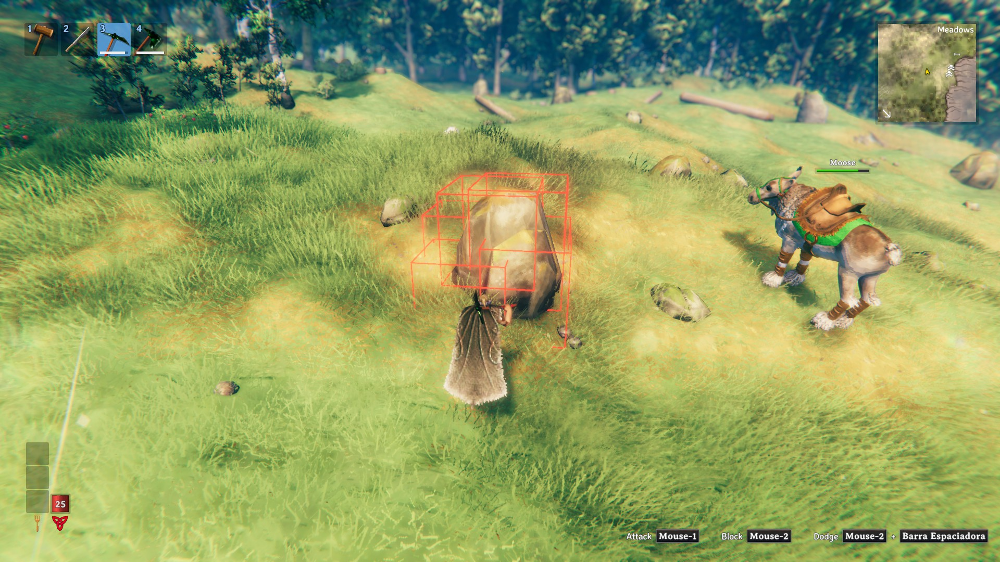

# OreHitboxVisualizer

Mod de BepInEx para Valheim que muestra la hitbox de soporte de cada trozo de los depósitos minables (cobre, plata, piedras grandes y cualquier roca `MineRock5`).

[English version](README.md)









- La hitbox aparece en cuanto golpeas el depósito por primera vez con el pico.
- **Rojo**: la caja del trozo está colisionando con algo (terreno, otra roca, construcciones) o está enterrada bajo el terreno. **Verde**: no toca nada. Los demás trozos del mismo depósito no cuentan.
- Al apuntar a un depósito aparece bajo su nombre cuántos nodos (trozos) tiene y cuántos colisionan / están libres.
- Solo se muestra un depósito a la vez: al picar otro distinto, desaparecen las hitboxes del anterior.
- La tecla **L** (configurable) muestra u oculta las hitboxes.

La caja que se dibuja es exactamente la que usa el juego (`MineRock5.UpdateSupport`): los `bounds` del collider de cada trozo, alineados a los ejes del mundo. Por eso a veces se ve más grande que el trozo.

## Configuración

`BepInEx/config/OreHitboxVisualizer.adrirf7.cfg`

| Opción | Por defecto | Descripción |
|---|---|---|
| `Enabled` | `true` | Estado de la tecla de mostrar/ocultar (se guarda). |
| `ToggleKey` | `L` | Tecla para mostrar/ocultar. |
| `PickaxeOnly` | `true` | Solo se activa al golpear con un pico. |
| `Mode` | `Collision` | `Collision`: rojo si toca algo fuera de su propio depósito (terreno, otras rocas, construcciones) o está enterrado bajo el terreno; los trozos del mismo depósito no cuentan. `Support`: rojo si el juego considera el trozo sostenido; verde = se caerá al romper el siguiente trozo. |
| `HideDistance` | `40` | Metros a partir de los cuales se quitan las hitboxes de ese depósito. |
| `HideAfterSeconds` | `0` | Segundos desde el último golpe para quitarlas (0 = nunca). |
| `ShowNodeCount` | `true` | Al apuntar a un depósito, muestra bajo su nombre cuántos nodos (trozos) tiene, cuántos colisionan y cuántos están libres. |
| `CollidingColor` / `FreeColor` | rojo / verde | Colores. |
| `LineThickness` | `0.03` | Grosor de las aristas (metros). |
| `HideHiddenEdges` | `true` | Dibujar solo las aristas que se ven: las que quedan detrás de la roca o el terreno se ocultan, y las libres (verdes) también detrás de otras cajas. Las que colisionan (rojas) nunca las tapan otras cajas. `false` = todas las aristas a través de todo. |

## Compilar

```
dotnet build -c Release
```

Copia el `.dll` a `BepInEx/plugins/OreHitboxVisualizer`. Otra ruta de Valheim: `-p:ValheimDir="D:\...\Valheim"`. Para no copiarlo al juego: `-p:DeployToGame=false`.

Una compilación Release crea además los paquetes de subida en `release/`:

- `OreHitboxVisualizer-<versión>-nexus.zip`: `BepInEx/plugins/OreHitboxVisualizer/OreHitboxVisualizer.dll`, para descomprimir en la carpeta de Valheim.
- `OreHitboxVisualizer-<versión>-thunderstore.zip`: `manifest.json`, `README.md`, `icon.png` y el DLL, de la carpeta `thunderstore/`.

### Desarrollo sin reiniciar el juego

Con [ScriptEngine](https://github.com/BepInEx/BepInEx.Debug) instalado (`BepInEx/plugins/ScriptEngine.dll`, con `LoadOnStart = true`, `EnableFileSystemWatcher = true` y `ReloadKey = F7` en `BepInEx/config/com.bepis.bepinex.scriptengine.cfg`):

- `dotnet build` (Debug) copia el DLL a `BepInEx/scripts/` y borra el de `plugins/`. Con el juego abierto, ScriptEngine recarga el mod unos 3 s después (o al pulsar **F7**).
- `dotnet build -c Release` lo vuelve a poner en `plugins/` (como lo instala un jugador), lo borra de `scripts/` y crea los zips.
- Al cambiar entre Debug y Release hay que reiniciar el juego una vez.
- Al recargar, el mod quita sus parches de Harmony y borra las cajas que había dibujado (`OnDestroy`). Las hitboxes de las rocas ya golpeadas desaparecen, así que hay que volver a darles un golpe.

Los textos de la página de Nexus Mods están en `nexus/`: `summary.txt` (resumen corto) y `description.bbcode` (descripción larga).
